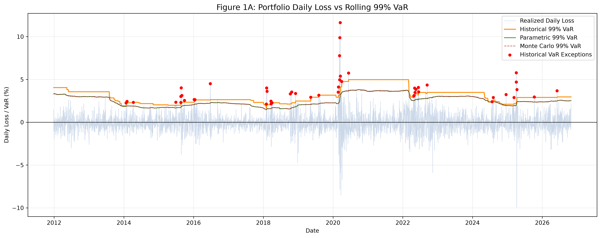
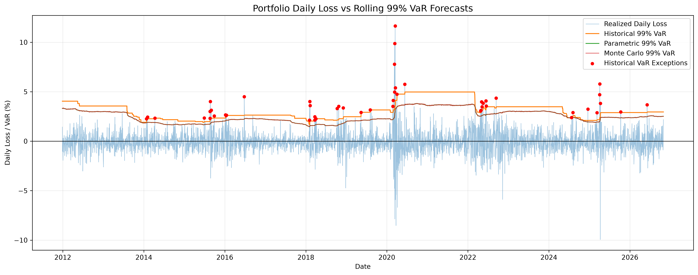
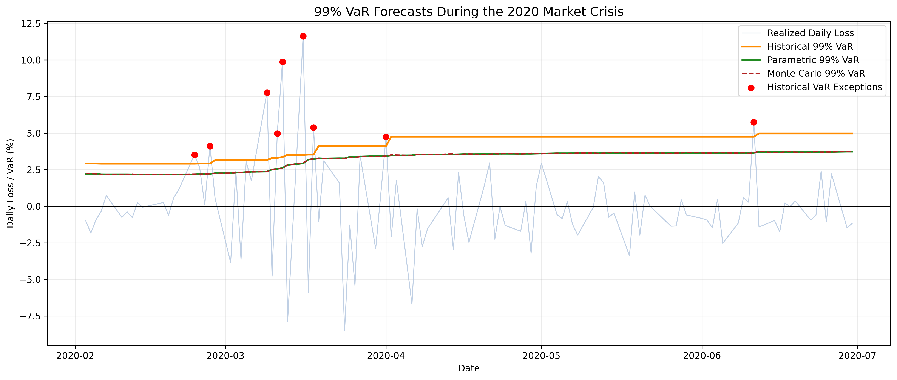
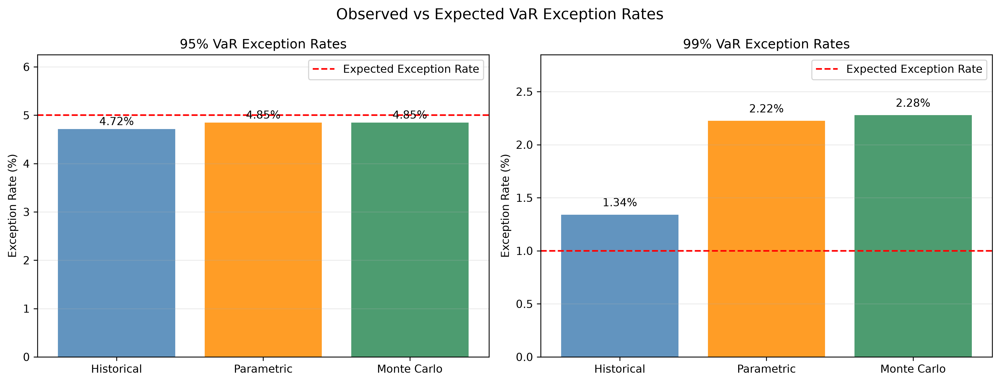
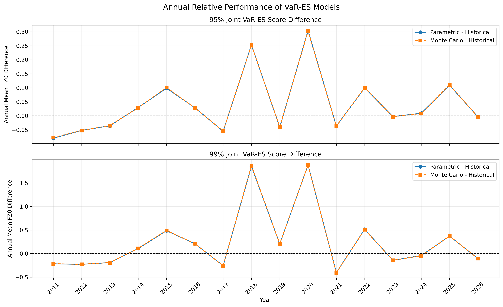
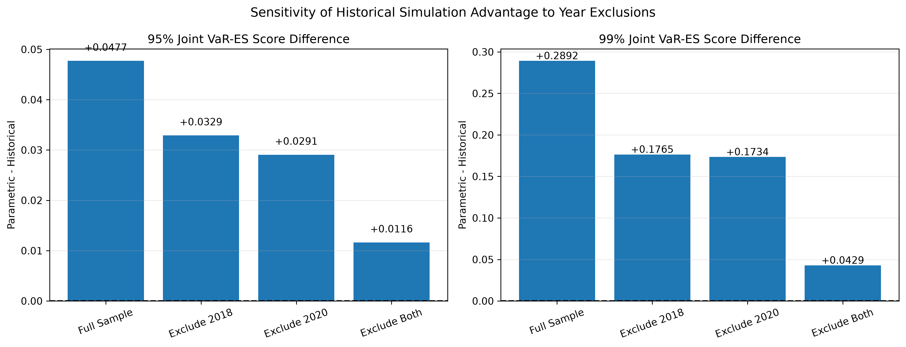

# Portfolio Value-at-Risk, Expected Shortfall & Backtesting

**An out-of-sample market risk model validation study using Historical Simulation, Gaussian Parametric, and Gaussian Monte Carlo methods.**

**Python · Market Risk · Model Validation · VaR / Expected Shortfall · Statistical Backtesting**

| Research scope | Specification |
|---|---|
| Portfolio | SPY (40%), QQQ (25%), IWM (15%), EFA (10%), EEM (10%) |
| Forecast horizon | One trading day ahead |
| Risk levels | 95% and 99% VaR and Expected Shortfall (ES) |
| Estimation | 500-trading-day rolling window |
| Out-of-sample evaluation | **3,732 daily forecasts per model**, December 28, 2011 – October 30, 2026 |
| Models | Historical Simulation, Gaussian Parametric, Gaussian Monte Carlo |
| Validation | Kupiec POF, Christoffersen independence and conditional coverage, FZ0 joint VaR–ES scoring, HAC inference, Holm correction |
| Automated tests | **72 passed** (latest reported local test run) |

> **Research takeaway.** All three models have approximately nominal 95% exception frequencies, but every model fails the Christoffersen independence test at both confidence levels. Historical Simulation delivers the lowest sample-average joint VaR–ES (FZ0) scores; however, **none of the six pairwise HAC score comparisons remains significant at the 5% family-wise level after Holm correction**. Historical Simulation's relative score advantage is also sensitive to crisis-year inclusion.

## 1. Research question and motivation

**How reliably do alternative VaR and ES models capture a multi-ETF portfolio's one-day downside risk, and do apparent differences in model performance survive statistical and temporal robustness checks?**

VaR estimates a loss threshold at a chosen confidence level; ES summarizes the severity of losses in the tail beyond that threshold. A credible validation exercise should go beyond comparing predicted risk levels or counting exceptions. It should also examine whether exceptions are clustered, how joint VaR–ES forecasts score, and whether any model advantage is statistically robust or concentrated in exceptional market periods.

This project is a **model validation exercise**, not a trading strategy, portfolio optimization system, or regulatory capital model.

## 2. Portfolio and research design

| ETF | Exposure | Weight |
|---|---|---:|
| SPY | U.S. large-cap equities | 40% |
| QQQ | Nasdaq-100 equities | 25% |
| IWM | U.S. small-cap equities | 15% |
| EFA | Developed-market equities outside the U.S. and Canada | 10% |
| EEM | Emerging-market equities | 10% |
| **Total** | | **100%** |

The data pipeline uses adjusted ETF closing prices and computes portfolio returns with fixed weights. The configured market-data window is January 1, 2010 (inclusive) through October 31, 2026 (exclusive). The prepared sample contains **4,233 price observations** and **4,232 daily return observations**. After a 500-day estimation period, the analysis evaluates **3,732 aligned, one-day-ahead forecasts** for each model, dated **2011-12-28 to 2026-10-30**.

Risk forecasts and realized losses are expressed in **decimal return units** internally; plotted figures may use percentages. The project's `src/config.py` also specifies a reference initial portfolio value of $1,000,000, but the reported backtests evaluate return-scale risk forecasts rather than dollar P&L.

### Three approaches

| Model | Method | Principal limitation |
|---|---|---|
| **Historical Simulation (HS)** | Empirical lower-tail quantile and fractional-tail average of past portfolio returns | Dependent on the rolling historical sample; abrupt regime changes may not be represented promptly |
| **Gaussian Parametric** | Closed-form VaR and ES from estimated portfolio mean and volatility | Normality can inadequately represent heavy tails and changing volatility |
| **Gaussian Monte Carlo (MC)** | Simulates correlated asset returns from an estimated multivariate normal distribution; estimates tail statistics from simulations | Shares Gaussian distributional assumptions with the parametric model and introduces sampling noise |

Under the loss convention \(L=-R_p\), the Gaussian formulas are

\[
\operatorname{VaR}_{c}=-\mu_p+\sigma_p\Phi^{-1}(c),\qquad
\operatorname{ES}_{c}=-\mu_p+\sigma_p\frac{\phi(\Phi^{-1}(c))}{1-c}.
\]

Here \(c\) is the confidence level. The Monte Carlo model is **not** a distinct heavy-tailed distribution model: its close agreement with the parametric model is expected under their common Gaussian assumptions.

## 3. Visual results

### Figure 1 — Full-sample 99% VaR and realized daily losses



The full-sample plot contrasts realized daily losses with rolling 99% VaR forecasts. Large loss spikes, especially during the 2020 market shock, exceed some preceding risk estimates. The historical estimate displays step-like adjustments characteristic of empirical tail quantiles.

### Figure 2 — 99% VaR exceedance events



Red markers identify **Historical Simulation** exceptions, not exceptions for all three models. Their timing illustrates why a full validation needs exceedance independence tests as well as unconditional frequency tests.

### Figure 3 — The 2020 market crisis



In the crisis window, the most extreme realized losses occur before the rolling forecasts fully adjust. The chart illustrates a potential weakness of backward-looking and slowly adapting risk estimates in a rapidly changing volatility regime; it does **not** independently establish statistical significance.

### Figure 4 — Observed versus expected VaR exception rates



At 95% confidence, observed exceedances are close to the nominal 5%. At 99%, all three models exceed the nominal 1%, most substantially for the Gaussian models. The significance of these differences is evaluated with the Kupiec test below.

### Figure 5 — Annual relative FZ0 performance



Positive differences (`Parametric − Historical` or `Monte Carlo − Historical`) indicate lower, better average scores for Historical Simulation within that year. The sign and magnitude change across years, and the **2011 and 2026 results cover partial evaluation years**. Annual plotted differences are descriptive rather than formal year-by-year significance tests.

### Figure 6 — Sensitivity to excluding 2018 and 2020



The full-sample Parametric-minus-Historical score difference is **+0.0477 at 95%** and **+0.2892 at 99%**. When both 2018 and 2020 are excluded, these differences fall to **+0.0116** and **+0.0429**, respectively. This shows that the observed average score advantage is sensitive to those years. These exclusion results alone do not establish statistical significance.

## 4. VaR exceedance backtesting

Define an exception by

\[
I_t=\mathbf{1}\!\left\{L_t>\widehat{\operatorname{VaR}}_t\right\},
\qquad L_t=-R_{p,t}.
\]

The **Kupiec proportion-of-failures (POF)** test examines unconditional exception frequency. The **Christoffersen independence (IND)** test examines first-order dependence in the exception sequence; the **conditional coverage (CC)** test jointly evaluates coverage and independence. All p-values below are from the project's reported results; decisions use a **nominal 5% significance level**.

| Model | VaR level | Exceptions / 3,732 | Exception rate | Kupiec p-value | Independence p-value | Conditional coverage p-value |
|---|---|---:|---:|---:|---:|---:|
| Historical | 95% | 176 | 4.72% | 0.4217 | 0.000072 | 0.000274 |
| Parametric | 95% | 181 | 4.85% | 0.6726 | 0.000488 | 0.002094 |
| Monte Carlo | 95% | 181 | 4.85% | 0.6726 | 0.000488 | 0.002094 |
| Historical | 99% | 50 | 1.34% | 0.04735 | 0.000040 | 0.0000306 |
| Parametric | 99% | 83 | 2.22% | 9.64 × 10⁻¹¹ | 0.000002 | 7.52 × 10⁻¹⁵ |
| Monte Carlo | 99% | 85 | 2.28% | 1.79 × 10⁻¹¹ | 0.000003 | 2.34 × 10⁻¹⁵ |

**Interpretation:** At 95%, the Kupiec null is not rejected for any model, while independence and conditional coverage are rejected for all three. At 99%, Kupiec, independence, and conditional coverage are rejected for all three models at the nominal 5% level. The Historical 99% Kupiec result is **borderline** (p ≈ 0.04735); non-rejection at a stricter threshold would not establish that the model is correctly specified.

**Why this matters:** A model can deliver approximately the expected **number** of exceptions without capturing the **time dependence** of those exceptions. Coverage adequacy and exception clustering are separate validation dimensions.

## 5. Joint VaR–ES evaluation: FZ0 scoring

Expected Shortfall is not adequately evaluated by VaR exception counts alone. This project compares **paired daily VaR–ES forecasts** using an FZ0 joint scoring function under a positive-loss convention. **Lower scores are better**, conditional on the scoring-rule and loss-scale conventions.

\[
S_t=\frac{\operatorname{VaR}_t}{\operatorname{ES}_t}
+\log(\operatorname{ES}_t)-1
+\frac{\mathbf{1}\{L_t>\operatorname{VaR}_t\}(L_t-\operatorname{VaR}_t)}{(1-c)\operatorname{ES}_t}.
\]

| Model | Mean FZ0 (95%) | Mean FZ0 (99%) |
|---|---:|---:|
| **Historical** | **−3.620178** | **−3.045914** |
| Parametric | −3.572465 | −2.756745 |
| Monte Carlo | −3.572331 | −2.755703 |

Historical Simulation has the lowest **sample mean** score at both confidence levels. This describes the observed ranking; it is **not**, by itself, evidence of statistically significant model superiority.

## 6. HAC comparisons and multiple-testing control

The study compares the daily **paired score differences** using an intercept-only regression with heteroskedasticity and autocorrelation consistent (HAC) standard errors and **10 lags**. Differences are defined as

\[
\overline d=\overline{S_B-S_A};\qquad
\overline d>0\ \Longrightarrow\ \overline{S_A}<\overline{S_B}.
\]

Thus, a positive mean difference favors **Model A** (lower FZ0 score). Six comparisons (three model pairs × two confidence levels) are treated as a **single multiplicity family** for Holm adjustment at a 5% family-wise error rate.

| Level | Model A vs Model B | Mean score difference (B − A) | HAC p-value | Holm-adjusted p-value | Significant after Holm? |
|---|---|---:|---:|---:|---|
| 95% | Historical vs Parametric | +0.047713 | 0.015213 | 0.087400 | **No** |
| 95% | Historical vs Monte Carlo | +0.047847 | 0.014567 | 0.087400 | **No** |
| 95% | Parametric vs Monte Carlo | +0.000134 | 0.741278 | 0.996415 | **No** |
| 99% | Historical vs Parametric | +0.289168 | 0.019491 | 0.087400 | **No** |
| 99% | Historical vs Monte Carlo | +0.290211 | 0.019033 | 0.087400 | **No** |
| 99% | Parametric vs Monte Carlo | +0.001042 | 0.498207 | 0.996415 | **No** |

**Statistical conclusion:** Four comparisons involving Historical Simulation have unadjusted p-values below 0.05, but **none of the six comparisons survives Holm correction**. The evidence supports a **descriptive** historical-model score advantage, not a 5%-family-wise-significant superiority claim. Lack of rejection is also **not proof of equivalence**, especially for the two Gaussian approaches.

## 7. Temporal stability and stress-year sensitivity

Annual relative FZ0 scores vary substantially across the sample. Excluding 2018, 2020, or both reduces the observed Historical Simulation score advantage versus Parametric. The comparison remains positive after excluding both years, but its magnitude becomes much smaller:

| Evaluation sample | 95% Parametric − Historical | 99% Parametric − Historical |
|---|---:|---:|
| Full sample | +0.0477 | +0.2892 |
| Exclude 2018 | +0.0329 | +0.1765 |
| Exclude 2020 | +0.0291 | +0.1734 |
| Exclude both | +0.0116 | +0.0429 |

These are **sensitivity diagnostics**, not independent causal attribution estimates or formal significance tests for each subsample. Taken together with exceedance clustering, they caution against treating the full-sample performance ordering as stable across all market regimes.

## 8. Model risk assessment and limitations

- **Distributional misspecification:** Gaussian models may underestimate tail risk when losses are heavy-tailed or volatility regimes shift. Monte Carlo simulation does not eliminate the shared normality assumption.
- **Historical lookback dependence:** A fixed 500-day window can lag major market regime changes and provides limited 99% tail observations (approximately five per window).
- **Exception dependence:** Significant Christoffersen independence rejections indicate that frequency calibration alone is insufficient.
- **Multiple comparisons:** Nominal pairwise p-values can overstate evidence when several model contrasts are investigated; Holm correction changes the inferential conclusion here.
- **Temporal concentration:** Relative score differences are sensitive to inclusion of 2018 and 2020. The partial evaluation years require careful interpretation.
- **Model scope:** The portfolio has fixed weights, one-day horizons, and equity ETF exposures. It does not model execution costs, liquidity-adjusted VaR, derivatives, dynamic rebalancing, or regulatory capital implementation.
- **Validation status:** Automated tests and numerical checks support implementation reliability, but an independent end-to-end code and data-timing audit should precede claims of production readiness. Statistical rejection does not directly quantify economic capital impact.

## 9. Repository guide

```text
portfolio-var-es-backtesting/
├── README.md
├── PROJECT_SPECIFICATION.md
├── run_phase1.py                 # Data collection / preprocessing pipeline
├── run_backtesting.py            # Coverage tests, FZ0 scores, HAC and Holm
├── generate_figures.py           # Figure generation
├── src/
│   ├── config.py
│   ├── data_loader.py
│   ├── portfolio.py
│   ├── historical_var.py
│   ├── parametric_var.py
│   ├── monte_carlo_var.py
│   └── backtesting.py
├── notebooks/
│   ├── 02_historical_var_es.ipynb
│   ├── 03_parametric_var_es.ipynb
│   ├── 04_monte_carlo_var_es.ipynb
│   ├── 05_var_es_backtesting.ipynb
│   ├── 06_results_visualization.ipynb
│   └── 07_final_audit.ipynb
├── tests/                        # 72 automated tests in the reported run
├── data/
│   ├── raw/                     # Ignored by Git
│   └── processed/
├── results/
│   ├── *_var_es_forecasts.csv
│   ├── var_backtesting_summary.csv
│   ├── fz0_score_summary.csv
│   ├── hac_model_comparison.csv
│   └── figures/                 # Six research figures
├── reports/
└── requirements.txt
```

For a narrative walkthrough, see **[`00_project_overview.ipynb`](00_project_overview.ipynb)** *once the overview notebook has been added to the repository*. The individual notebooks contain model development and diagnostics; `src/` contains the reusable implementations.

## 10. Getting started

Python **3.11** was used in the reported local test run.

```bash
# From the repository root
python3 -m venv .venv
source .venv/bin/activate       # macOS / Linux
python -m pip install -r requirements.txt

# Confirm local unit and integration tests
python -m pytest tests/ -v
```

The latest reported run completed **72/72 tests** successfully. `requirements.txt` lists the required packages but is not version-pinned; exact cross-machine reproducibility depends on recording the environment versions and market-data vintage.

### Reading the supplied results

The quickest path for a reviewer is to open the overview notebook and the committed files under `results/`, without recomputing the full rolling simulation. To reproduce or extend the workflow locally:

1. Review `PROJECT_SPECIFICATION.md` and `src/config.py` for the frozen sample and portfolio settings.
2. Run `python run_phase1.py` to download and prepare market data (requires network access; subsequent data-vendor revisions may affect outputs).
3. Execute the model notebooks **02 → 03 → 04** in order to generate the forecast CSV files, if they are not already present.
4. Run `python run_backtesting.py` to regenerate the backtesting, FZ0, HAC, and Holm tables from the saved model forecasts.
5. Use `python generate_figures.py` and the analysis/visualization notebooks to inspect or refresh the figures.
6. Run `python -m pytest tests/ -v` and inspect `notebooks/07_final_audit.ipynb` for additional validation checks.

> **Important:** Model-generation notebooks, data download behavior, and the complete end-to-end run should be checked in the published repository before describing the workflow as fully reproducible. Saved outputs allow review without requiring every reader to re-run simulations.

## 11. Key conclusions

1. **Near-nominal exception frequency is not sufficient validation.** All 95% models pass Kupiec POF, yet all fail the independence and conditional coverage tests at the nominal 5% level.
2. **The 99% tail is more challenging.** Every model fails 99% unconditional coverage, with substantially elevated exception frequencies for the Gaussian approaches.
3. **Historical Simulation ranks first on sample-average FZ0 scores**, but no pairwise advantage survives Holm correction at the 5% family-wise level.
4. **Stress years materially influence the descriptive ranking.** Removing both 2018 and 2020 sharply reduces the observed historical-model score advantage.
5. **The relevant output is a multi-dimensional model risk assessment**, not an unconditional recommendation of a single superior model.

## 12. Possible research extensions

Potential next steps include filtered historical simulation, Student-*t* or GARCH-based forecasts, alternative lookback windows, independent ES-specific diagnostics, explicit HAC lag sensitivity, and stress testing. These are **future extensions**, not implemented results in this repository.

---

**Project purpose:** Demonstrate applied market risk measurement, statistical model validation, and reproducible Python research relevant to **Market Risk, Quantitative Risk Modeling, and Model Validation** roles.
